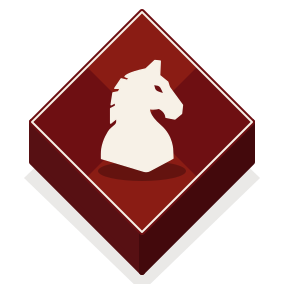
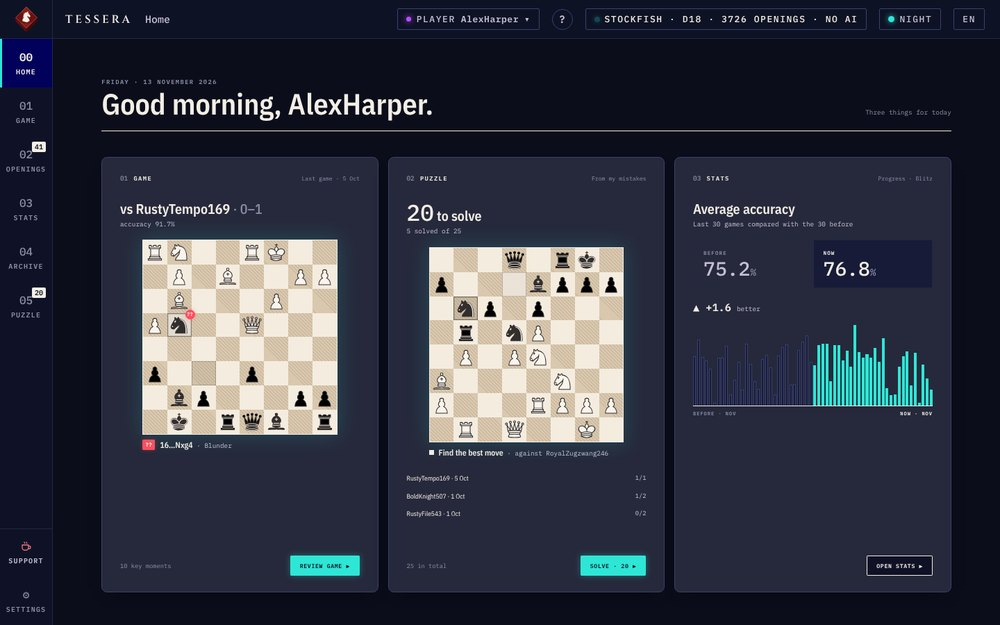
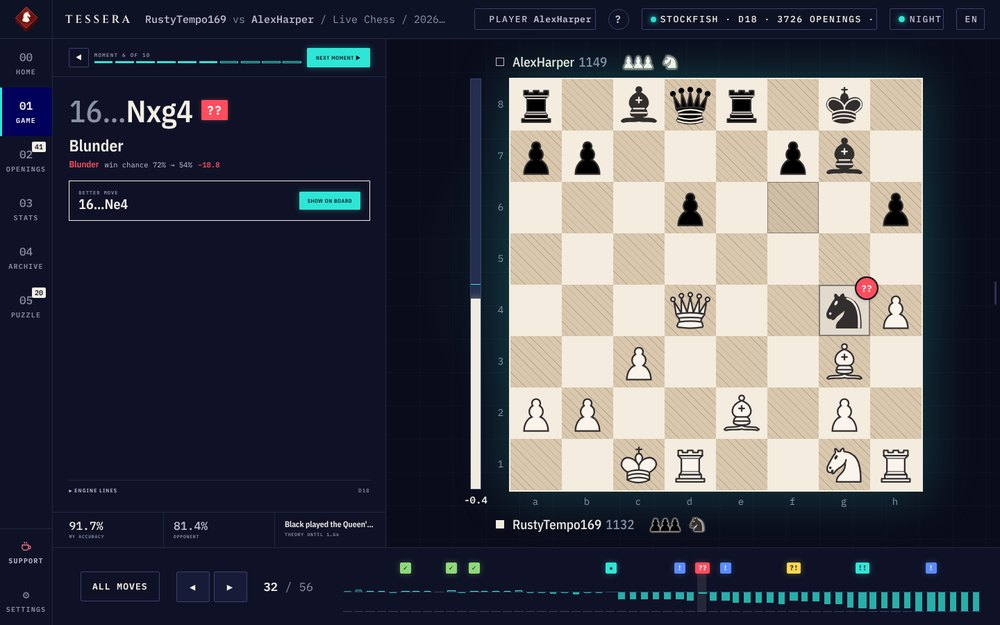
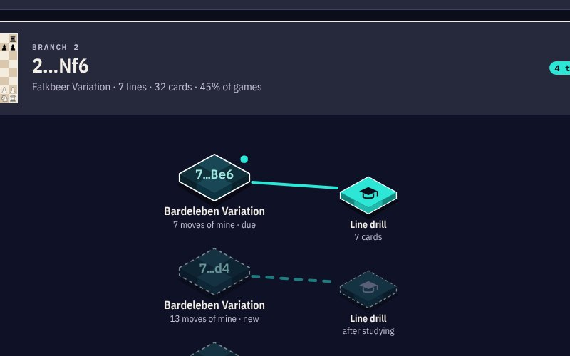
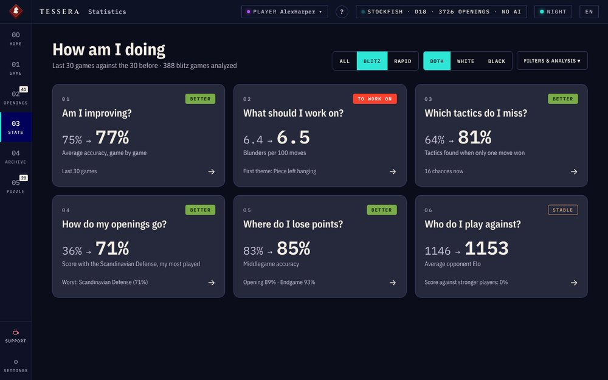
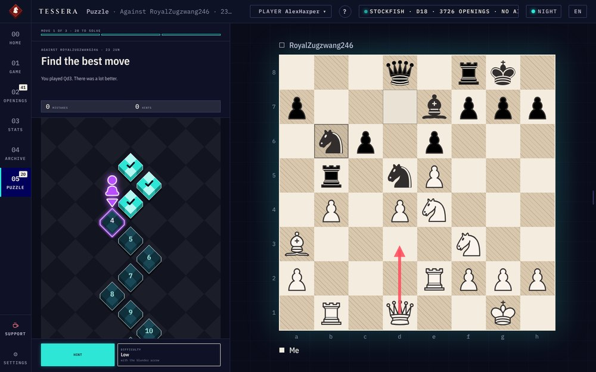
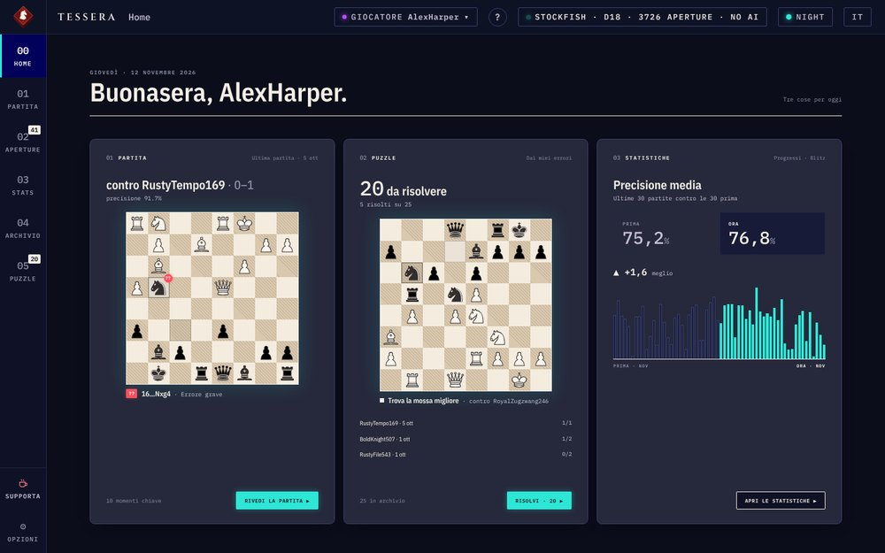

<p align="center">
  
</p>

<h1 align="center">TESSERA</h1>

<p align="center">
  Learn from <b>your own</b> chess games: review, openings, statistics and puzzles built from your mistakes.<br>
  Free, open source, runs on your computer.
</p>

<p align="center">
  <a href="#english">English</a> · <a href="#italiano">Italiano</a> ·
  <a href="https://github.com/grassopher03ux/tessera/releases/latest">Download for Windows</a> ·
  <a href="https://paypal.me/MattiaColombo284">Buy me a coffee</a>
</p>

<p align="center">
  
</p>

---

## English

Tessera imports your games from chess.com, analyzes them with **Stockfish** and turns them into
practice: the moments where the game turned, the openings you play, what to work on, and
puzzles taken from your own blunders.

Everything runs **locally**: your games and progress stay in a file on your computer.

### What it does

| | |
| --- | --- |
| **01 · Game** — Stockfish rates every move (brilliant, best, inaccuracy, mistake, blunder) and points out the key moments, with the evaluation graph and the engine lines. |  |
| **02 · Openings** — your repertoire as cards, branches and lines. Study a line move by move, then drill it with spaced repetition. |  |
| **03 · Stats** — six plain questions about your last 30 games compared with the 30 before: am I improving, what should I work on, which tactics do I miss, how are my openings going. |  |
| **05 · Puzzle** — positions where you went wrong in your own games, rebuilt as puzzles: find the move you missed. |  |

The interface comes in Italian and English, with a light theme (Lattice) and a dark theme (Night).

### Install (Windows)

1. Download `Tessera.zip` from the [latest release](https://github.com/grassopher03ux/tessera/releases/latest) and unzip it anywhere.
2. Double-click `Tessera.exe`. If Windows shows "Windows protected your PC", click **More info → Run anyway**.
   A black window opens (it is the app's engine): keep it open while you use Tessera.
3. Your browser opens at `http://localhost:5000`. Type your chess.com username: Tessera imports the
   last 3 months of games and starts analyzing them. It takes a few minutes, and you can use the app meanwhile.

Stockfish is already included in the release.

### Run from source

You need **Python 3.10+** and a [Stockfish](https://stockfishchess.org/download/) executable.

```bash
git clone https://github.com/grassopher03ux/tessera.git
cd tessera
pip install -r requirements.txt
python server.py
```

Then open `http://localhost:5000`. Put the Stockfish executable in the same folder, or set its path in
**Settings**. `config.example.json` shows the available options; Tessera creates its own `config.json` on first run.
On Windows you can also double-click `start.bat`.

### Optional: AI comments

Written comments on moves and openings use the OpenAI API with **your own** key. Create a file
called `.env` next to the app with one line:

```
OPENAI_API_KEY=sk-your-key
```

Without it, Tessera works the same, just without the AI comments. The key never leaves your computer
except to call OpenAI.

### Your repertoire

The openings come from `static/openings.json` (groups by color → lines with name, ECO and PGN). The
included file is an example repertoire. Edit it with your own lines, then press **Update** on the
opening card. Opening names come from the [Lichess opening database](https://github.com/lichess-org/chess-openings).

### Privacy

- Games are downloaded from chess.com's public API, using the username you type.
- Games, analysis and progress are saved only in `chess_reviewer.db`, in the app folder.
- No account, no tracking, no data sent anywhere, apart from chess.com (to fetch games) and OpenAI (only if you add a key).

### Support the project

Tessera is free. If it helps your chess, you can [buy me a coffee](https://paypal.me/MattiaColombo284)
or leave a ⭐ on this repository. You will also find **Support** in the app's side menu.

### License

[GPL-3.0](LICENSE) © 2026 Mattia Colombo. Stockfish, libraries, fonts and pieces are credited in
[CREDITS.md](CREDITS.md). Tessera is an independent project, not affiliated with Chess.com, Lichess,
the Stockfish project or OpenAI.

---

## Italiano

Tessera importa le tue partite da chess.com, le analizza con **Stockfish** e le trasforma in
allenamento: i momenti in cui la partita è girata, le aperture che giochi, su cosa lavorare e dei
puzzle presi dai tuoi errori.

Funziona **in locale**: partite e progressi restano in un file sul tuo computer.

<p align="center"></p>

### Cosa fa

- **01 · Partita**: Stockfish classifica ogni mossa (brillante, migliore, imprecisione, errore, errore grave) e segna i momenti chiave, con il grafico della valutazione e le linee del motore.
- **02 · Aperture**: il tuo repertorio in card, rami e linee. Studi una linea mossa per mossa, poi la ripassi con la ripetizione dilazionata.
- **03 · Statistiche**: sei domande semplici sulle ultime 30 partite confrontate con le 30 precedenti (sto migliorando? su cosa devo lavorare? quali tattiche mi sfuggono? come vanno le mie aperture?).
- **05 · Puzzle**: le posizioni in cui hai sbagliato nelle tue partite, trasformate in esercizi: trova la mossa che ti è sfuggita.

L'interfaccia è in italiano e in inglese, con un tema chiaro (Lattice) e uno scuro (Night).

### Installazione (Windows)

1. Scarica `Tessera.zip` dall'[ultima release](https://github.com/grassopher03ux/tessera/releases/latest) ed estrailo dove vuoi.
2. Doppio clic su `Tessera.exe`. Se Windows mostra "PC protetto da Windows": **Ulteriori informazioni → Esegui comunque**.
   Si apre una finestra nera (è il motore dell'app): lasciala aperta mentre usi Tessera.
3. Il browser si apre su `http://localhost:5000`. Scrivi il tuo username chess.com: Tessera importa le
   partite degli ultimi 3 mesi e inizia ad analizzarle. Ci vuole qualche minuto, ma puoi già usarla.

Stockfish è già incluso nella release.

### Avvio dal codice sorgente

Serve **Python 3.10+** e un eseguibile di [Stockfish](https://stockfishchess.org/download/).

```bash
git clone https://github.com/grassopher03ux/tessera.git
cd tessera
pip install -r requirements.txt
python server.py
```

Poi apri `http://localhost:5000`. Metti Stockfish nella stessa cartella oppure indica il percorso in
**Opzioni**. Le opzioni disponibili sono in `config.example.json`; Tessera crea il suo `config.json` al primo avvio.
Su Windows basta anche un doppio clic su `start.bat`.

### Facoltativo: commenti AI

I commenti scritti alle mosse e alle aperture usano l'API di OpenAI con **la tua** chiave. Crea accanto
all'app un file `.env` con una sola riga:

```
OPENAI_API_KEY=sk-la-tua-chiave
```

Senza chiave Tessera funziona lo stesso, solo senza i commenti AI.

### Il tuo repertorio

Le aperture sono in `static/openings.json` (gruppi per colore → linee con nome, ECO e PGN). Il file
incluso è un repertorio di esempio: modificalo con le tue linee e premi **Aggiorna** sulla card
dell'apertura. I nomi delle aperture vengono dal [database aperture di Lichess](https://github.com/lichess-org/chess-openings).

### Privacy

- Le partite vengono scaricate dall'API pubblica di chess.com, con l'username che scrivi tu.
- Partite, analisi e progressi sono salvati solo in `chess_reviewer.db`, nella cartella dell'app.
- Niente account, niente tracciamento, nessun dato inviato altrove, a parte chess.com (per scaricare le partite) e OpenAI (solo se aggiungi una chiave).

### Supporta il progetto

Tessera è gratuita. Se ti aiuta, puoi [offrirmi un caffè](https://paypal.me/MattiaColombo284) o
lasciare una ⭐ al repository. Nell'app trovi anche la voce **Supporta** nel menu laterale.

### Licenza

[GPL-3.0](LICENSE) © 2026 Mattia Colombo. Crediti di Stockfish, librerie, font e pezzi in
[CREDITS.md](CREDITS.md). Tessera è un progetto indipendente, non affiliato a Chess.com, Lichess, al
progetto Stockfish o a OpenAI.
